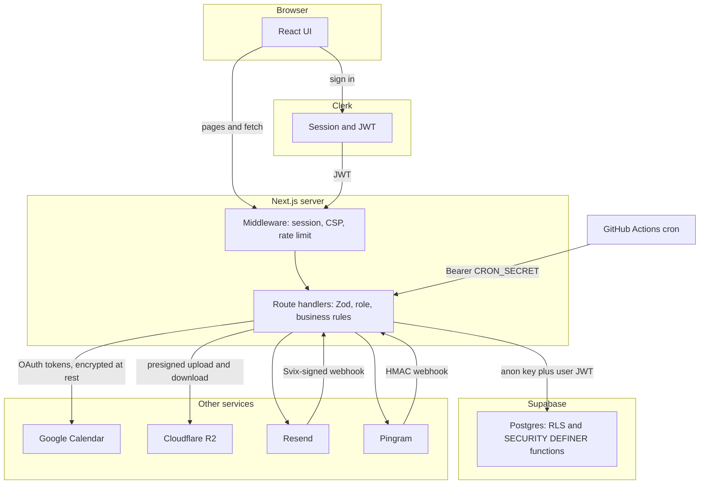

# Graceful

Graceful is a scheduling and setlist app for a worship team: who is playing, what they are playing, and the files that go with the songs.

## Product overview

A church group has admins, set leaders, members, and guests. Leaders build a service week, invite the team, and publish a setlist. Members accept or decline, and an accepted member who marks that date unavailable opens a scheduling conflict. Songs belong to the group. Files for a song are stored in Cloudflare R2 and shown on the member's week view.

The app is a Next.js App Router project. The browser talks to Next.js route handlers. Those handlers validate input with Zod, check the caller's role, and read Postgres through a Supabase client that carries the user's Clerk JWT. Row-level security is the second check on the same identity.

Sign-in is Clerk. Email goes through Resend. SMS goes through Pingram. A connected member can have service events written to Google Calendar. A web app manifest and an install prompt are included. Offline caching would need a service worker, and this repo does not have one.

The product requirements in [`documentation/prd/graceful_requirements_v10.md`](documentation/prd/graceful_requirements_v10.md) also describe transcription, chat, and later scheduling models. [Features](#features) records which of those exist in this repository.

## Screenshots

This repo has no product screenshots. `public/icons/` holds the PWA icons (`icon.svg`, `icon-maskable.svg`, `icon-192.png`, `icon-512.png`). Those are not pictures of the app.

Capture these from a signed-in staging or local session and drop them in `documentation/screenshots/` when you have them:

1. Signed-out home (`/`).
2. Clerk sign-in (`/sign-in`).
3. Admin dashboard (`/dashboard`) with at least one service week.
4. Week view (`/week/[id]`): roster, guest invite, availability grid.
5. Member week (`/member-week/[id]`): events, team, and any song files.
6. Setlist builder (`/setlists/[id]`) with a draft list.
7. Invitation response (`/invitations/[id]` or the public `/invite/[token]` page).
8. Conflicts list (`/conflicts`) and one resolution screen (`/conflicts/[id]`).
9. Notification inbox (`/notifications`).
10. Join page (`/join/[code]`).

A phone shot of the install prompt is optional. The prompt only appears in a supporting browser, and iOS Safari gets written instructions instead of a native prompt.

## Live demo

[https://graceful-wheat.vercel.app](https://graceful-wheat.vercel.app)

Checked on 2026-11-19:

- `GET /` returned 200 and the home page title Graceful.
- `GET /api/health` returned 200 and `{"data":{"status":"ok"}}`.
- `GET /sign-in` returned 200.
- `GET /manifest.webmanifest` returned 200.
- `GET /dashboard` without a Clerk browser session returned 404. The response header `x-clerk-auth-reason` was `protect-rewrite, dev-browser-missing`. The HTML loads a Clerk development publishable key (`pk_test_`) and a `*.clerk.accounts.dev` script. This deployment is on a Clerk development instance.

There is no demo login in the repo. The home page is public. The rest of the product needs an account in that Clerk instance and a `users` row in the matching Supabase project.

## Features

**Complete** means a person can do the thing in the UI and the API behind it checks auth and input. **Partial** means the API, the screen, or both exist, and the gap is named. **Planned** means a stub, a disabled control, or a requirements note only.

| Feature                             | Status   | What the code does                                                                                                                                                                                                                                                                                                                                                                                                                                                                    |
| ----------------------------------- | -------- | ------------------------------------------------------------------------------------------------------------------------------------------------------------------------------------------------------------------------------------------------------------------------------------------------------------------------------------------------------------------------------------------------------------------------------------------------------------------------------------- |
| Weekly scheduling                   | Partial  | Leaders get a dashboard (`/dashboard`) of service weeks, with date filters, setlist status, confirmations, and open conflicts. The week screen invites members and guests and shows a team availability grid. The member week screen lists events, the published songs, and files. On the leader week screen the Events and Setlist blocks are still placeholders (`app/(app)/week/[id]/week-view.tsx`). Event create, update, delete, attendees, and ICS export exist as API routes. |
| Invitations                         | Complete | Leaders invite a member or a guest from the week screen. Accept and decline work in the app and from a token link. Guests claim an account at `/guest/[token]`. New members join with an invite code at `/join/[code]`. Email and SMS are dispatched when Resend and Pingram are configured. A denial cap blocks a fourth invite for the same week after three denials (`lib/invitations/state-machine.ts`).                                                                          |
| Conflict detection                  | Complete | Marking a date unavailable, or deleting that availability, records a conflict for each accepted invitation on a service that day (`record_availability_conflict`). Leaders get an in-app notification plus email and SMS. `/conflicts` lists open conflicts. Resolution is replace, withdraw, member reconfirmed, or admin dismissed.                                                                                                                                                 |
| Setlists and songs                  | Partial  | `/setlists/[id]` searches the catalog, quick-adds a song, reorders, sets a key and notes, publishes, and unlocks. Publishing notifies the team. The leader week screen does not link here. The builder is reached from a notification whose link type is `setlist`.                                                                                                                                                                                                                   |
| Song files                          | Partial  | Leaders can request a presigned R2 upload, register the file, list files, and delete them (`/api/songs/:id/documents`). The member week view renders download links for the week's songs. `/documents` is a coming-soon heading. There is no upload screen.                                                                                                                                                                                                                           |
| Google Calendar                     | Partial  | A signed-in user can start OAuth at `POST /api/google-calendar/connect`. The callback stores the refresh token with AES-256-GCM (`TOKEN_ENCRYPTION_KEY`) and syncs existing events. Creating, updating, deleting, or reassigning an event updates connected calendars. There is no connect or disconnect screen. Cancelling a service week does not remove those calendar events (the handler still has that TODO). Conflict resolution has the same gap.                             |
| Sign-in and access control          | Complete | Clerk hosts sign-in and sign-up. Middleware protects every route that is not on the public list. Handlers load the caller's role from `users` and call `requireRole` where the action is limited to admins or set leaders. Postgres policies enforce the same tenant boundary. Details are in [Authentication and database design](#authentication-and-database-design).                                                                                                              |
| Notifications                       | Partial  | The inbox at `/notifications` lists, filters, and marks items read. The bell in the shell shows an unread count. Invitation, conflict, setlist, event, and reminder flows call `dispatchNotification`, which sends SMS through Pingram and email through Resend and writes the in-app row. Preference get and update exist at `/api/notifications/preferences` and have no screen.                                                                                                    |
| Availability                        | Partial  | A member can set or clear their own dates through the API. That write is what opens a conflict. Leaders see the grid on the week screen. There is no screen where a member edits their own availability. `GET /api/church-group/members` always returns `availabilityStatus: null`.                                                                                                                                                                                                   |
| Progressive web app                 | Partial  | `app/manifest.ts` serves `/manifest.webmanifest` (standalone, start URL `/dashboard`). Icons and `app/apple-icon.tsx` are present. `InstallPrompt` handles `beforeinstallprompt` and shows iOS Safari steps. There is no service worker, so the app does not cache for offline use.                                                                                                                                                                                                   |
| Church group, profile, instruments  | Partial  | Creating a group is `PUT /api/church-group` (Clerk session, no `users` row yet). Joining is the `/join/[code]` form. Role changes and member removal are API routes. `GET /api/church-group` returns 501. `/profile` prints the Clerk name and email. It does not call `GET /api/profile` or `PUT /api/profile`. Instrument catalog routes have no screen.                                                                                                                            |
| Transcription, Spotify lookup, chat | Planned  | `lib/spotify/client.ts`, `lib/upstash/redis.ts`, `lib/upstash/qstash.ts`, and `verifyModalWebhook` throw. `POST /api/webhooks/modal` and `POST /api/webhooks/clerk` return 501. The member week view has a disabled chat button. `next.config.ts` mentions a `song2score/` directory. That directory is not in the repo, and there are no Python files.                                                                                                                               |

## Architecture



Trust boundaries, from the outside in:

1. The browser reaches Next.js and Clerk. The Supabase client is created only in server code (`lib/supabase/client.ts`). The service-role key is not part of that client.
2. Clerk is the identity provider. The app trusts a verified session, then looks up `users` by `clerk_id`. A session with no row is not a member yet.
3. Middleware is the request boundary. It rejects unauthenticated access to non-public routes, attaches the CSP, and applies the rate limit.
4. Route handlers are the application boundary. They validate input, check role, and apply rules such as the 72-hour event window and the invitation state machine.
5. Postgres is the data boundary. The handler's Supabase client sends the user JWT, and row-level security applies. Functions marked `SECURITY DEFINER` are the exception, and they are where the SQL itself re-checks the caller.
6. Resend and Pingram webhooks are public routes. They are accepted only after signature verification. The Clerk and Modal webhook routes are public too, and both return 501.
7. Cron is a separate caller. It proves itself with `CRON_SECRET`, not with a user session.

The longer version of these rules is [`documentation/architecture.md`](documentation/architecture.md).

## Authentication and database design

Roles on `users.role` are `admin`, `set_leader`, `member`, and `guest`.

Public routes in `middleware.ts` are `/`, sign-in, sign-up, `/join`, `/invite`, `/guest`, `/api/health`, `/api/webhooks/*`, the invitation accept, deny, and token-respond URLs, `/apple-icon`, and `/manifest.webmanifest`. Everything else requires a Clerk session. Accept and deny are public at the middleware so an email link can post a `responseToken`. Without that token the handler requires a session, and the SQL function requires the caller to be the invited user.

`requireAuth` maps the Clerk id to the internal user id, church group, and role. Leader and admin actions call `requireRole`. The dashboard, setlist builder, conflict list, and event writes are limited to `admin` and `set_leader`. Audit-log reads are admin only. Members read their own notifications, availability, and profile. Guests only see events on weeks where their invitation is still pending or accepted.

The Clerk JWT is also the Supabase JWT. RLS helpers (`auth_user_id`, `auth_church_group_id`, `auth_user_role`) read `sub` and, when present, `church_group_id` and `role` claims. The claims are optional. The helpers fall back to the `users` table. `POST /api/webhooks/clerk` is still a 501, so a new person is inserted by `create_church_group`, `join_church_group`, or `provision_guest_user`, not by a Clerk webhook.

Tables the client types know about (`lib/supabase/types.ts`):

| Area                   | Tables                                                                                   |
| ---------------------- | ---------------------------------------------------------------------------------------- |
| Group and people       | `church_groups`, `users`, `member_profiles`, `instruments`, `member_instruments`         |
| Schedule               | `service_weeks`, `events`, `event_attendees`, `invitations`, `conflicts`, `availability` |
| Music                  | `songs`, `song_documents`, `setlists`, `setlist_songs`                                   |
| Messages               | `notifications`, `notification_preferences`                                              |
| Integrations and audit | `google_calendar_tokens`, `audit_logs`, `practice_reminder_sends`, `app_secrets`         |

`church_groups` allows an authenticated user to select their own group and nothing else. `google_calendar_tokens` are limited to the owning user. `audit_logs` can be selected by admins. Update and delete on `audit_logs` are revoked. `app_secrets` and `practice_reminder_sends` have row-level security enabled, no policies, and grants revoked from `anon` and `authenticated`.

Migrations live in `supabase/migrations/` and are the schema source of truth. Apply notes are in [`supabase/README.md`](supabase/README.md). Two statements in that file's original "gaps" list are historical: `church_groups` now has the select policy above, and `setlist_songs.song_id` now has a foreign key to `songs`.

## Security considerations

This is a description of checks in the repo. It is not a certification, a penetration test, or a claim that every OWASP category was reviewed.

- **Session and role.** Clerk middleware plus `requireAuth` / `requireRole`. Cross-tenant reads are also limited by RLS policies keyed on the JWT.
- **Service role.** The service-role key bypasses RLS. `scripts/check-service-role.mjs` scans `app/` and `lib/` for references outside comments. Playwright and the RLS suite use that key for seed and teardown only, from `tests/`, not from the app.
- **Input.** Zod schemas cover JSON bodies and query parameters that the handlers accept. Song search escapes user text before it is placed in a PostgREST filter. There is a unit suite for injection-shaped payloads (`tests/unit/schemas/input-validation-injection.test.ts`).
- **Browser policy.** `next.config.ts` sets HSTS (`max-age=63072000; includeSubDomains; preload`). Vercel redirects HTTP to HTTPS. CSP is built per request with a nonce. Production `script-src` does not include `'unsafe-inline'` or `'unsafe-eval'`. `style-src` does include `'unsafe-inline'`, because Next.js and Clerk inject styles. `'unsafe-eval'` and a dev websocket are added only when `NODE_ENV` is not `production`. The root layout forces dynamic rendering so the nonce exists on every page.
- **Rate limits.** Fixed windows, stored in a process-local `Map`. They are not shared across instances. Current limits per minute: webhook 600, read 240, write 60, auth 50, invite 30, SMS-triggering routes 5. Anonymous callers are keyed by the first `x-forwarded-for` hop, which is safe on Vercel because Vercel overwrites that header. A different proxy in front of the app would make that key caller-controlled.
- **Webhooks.** Pingram callbacks are HMAC-checked, rejected when the timestamp is outside five minutes, and only logged. Resend callbacks are verified with Svix. Neither route is a Clerk session.
- **Calendar tokens.** Refresh tokens are encrypted with AES-256-GCM before insert. The key is `TOKEN_ENCRYPTION_KEY`, a 32-byte base64 value.
- **Cron.** Both reminder routes return 500 when `CRON_SECRET` is unset and 401 when the bearer token does not match. Practice-reminder SQL also checks the secret against `app_secrets`. Invitation-reminder SQL does not. That function is granted to `anon`, so the bearer check for invitation reminders is only in the Next.js route. If the hosted Data API is reachable with the anon key, that function can be called without the bearer header.
- **Secrets in git.** CI checks out full history and runs `bun run check:git-secrets`. Dependabot opens weekly updates for Bun dependencies and GitHub Actions.
- **Dependency audit.** The `checks` job runs `bun audit --audit-level=high`.
- **Written reviews.** [`documentation/infrastructure-security.md`](documentation/infrastructure-security.md) is the HTTPS, CSP, secret-scan, and Dependabot note. Rate limiting and Zod validation were added after that note was first written. [`documentation/owasp-top-10-review.md`](documentation/owasp-top-10-review.md) is a manual review dated 2026-08-08 of broken access control, cryptographic failures, injection, security misconfiguration, and identification failures. It is tied to a specific commit. It does not cover the other five OWASP Top 10 categories, and it is not a live test. `bun run check:owasp` fails CI if that document still has an open finding. Some sentences in it predate the notification inbox.

Google OAuth and the R2 bucket are provisioned by hand. The runbook is [`documentation/google-oauth-r2-provisioning.md`](documentation/google-oauth-r2-provisioning.md).

## Testing and CI

| Suite           | Command             | What it covers                                                                                                                                                                                                | When it runs                                                                                                                                                                                                      |
| --------------- | ------------------- | ------------------------------------------------------------------------------------------------------------------------------------------------------------------------------------------------------------- | ----------------------------------------------------------------------------------------------------------------------------------------------------------------------------------------------------------------- |
| Unit            | `bun run test`      | Jest, `tests/unit` only. API handlers, schemas, middleware, UI components, and library modules, with Supabase and Clerk mocked.                                                                               | Every pull request, as `bun run test:coverage` inside the `checks` job.                                                                                                                                           |
| RLS integration | `bun run test:rls`  | Jest with `jest.config.integration.js`, against a real Postgres. Cross-tenant access, role gates, and the church-group functions.                                                                             | CI job `rls-integration` only when the `SUPABASE_TEST_URL` secret is non-empty. The suite itself also skips unless `SUPABASE_TEST_ANON_KEY`, `SUPABASE_TEST_SERVICE_ROLE_KEY`, and `SUPABASE_JWT_SECRET` are set. |
| End to end      | `bun run test:e2e`  | Playwright, 11 spec files under `tests/e2e`. Health, invitation accept and deny, guest claim, reminder, conflicts, setlist publish, duplicate song, notification inbox, week setup, and Google Calendar sync. | CI job `e2e` only when `STAGING_APP_URL` is set. Calendar sync skips unless its Google secrets are set. The week-setup and new-guest cases skip unless `E2E_SETUP_ADMIN_EMAIL` and `E2E_GUEST_EMAIL` are set.     |
| Load            | `bun run test:load` | A small TypeScript harness in `tests/load`.                                                                                                                                                                   | Not a CI job. The results table in [`documentation/performance-testing.md`](documentation/performance-testing.md) is still unfilled.                                                                              |

CI is `.github/workflows/ci.yml`. It runs on `pull_request` only. It does not deploy.

Jobs that always run:

- `checks`: frozen Bun install, `typecheck`, `lint`, `check:workflows`, `check:owasp`, `test:coverage`, `bun audit --audit-level=high`.
- `git-secret-scan`: full git history, `bun run check:git-secrets`.
- `check-secrets`: always runs, and only records whether `SUPABASE_TEST_URL` and `STAGING_APP_URL` are set.

Jobs that run only when a secret is present:

- `rls-integration` when `SUPABASE_TEST_URL` is set. It applies every `supabase/migrations/*.sql` file except `*.down.sql`, then runs `bun run test:rls`.
- `e2e` when `STAGING_APP_URL` is set. It installs Playwright browsers and runs `bun run test:e2e` against that URL.

On a recent green run of this workflow, `e2e` and `rls-integration` were skipped. A skipped job does not fail the workflow.

Two more workflows are scheduled, not part of the pull-request CI file:

- [Invitation reminders](.github/workflows/invitation-reminders-cron.yml) calls `GET /api/cron/invitation-reminders` hourly.
- [Practice reminders](.github/workflows/practice-reminders-cron.yml) calls `GET /api/cron/practice-reminders` hourly.

Each workflow skips the HTTP call unless both `STAGING_APP_URL` and `CRON_SECRET` are set. The job still succeeds when the call is skipped.

There is no CI badge in this README. The badge for `ci.yml` currently renders a failing state, because the latest run of that workflow failed. Adding it would advertise a red check.

`bun run check:service-role` is a local guard. It is not a step in `ci.yml`.

## Local development

Requires [Bun](https://bun.sh). CI installs `1.2.x`.

```bash
bun install
bun run dev
```

Open http://localhost:3000.

Copy `.env.example` to a file that is not committed and fill values there. Names stay the same in every environment. Only the values change. Do not commit values.

| Group           | Variable names                                                                                                                                                                                                                                          |
| --------------- | ------------------------------------------------------------------------------------------------------------------------------------------------------------------------------------------------------------------------------------------------------- |
| App             | `NEXT_PUBLIC_APP_URL`                                                                                                                                                                                                                                   |
| Supabase        | `NEXT_PUBLIC_SUPABASE_URL`, `NEXT_PUBLIC_SUPABASE_ANON_KEY`, `SUPABASE_SERVICE_ROLE_KEY`                                                                                                                                                                |
| Clerk           | `NEXT_PUBLIC_CLERK_PUBLISHABLE_KEY`, `CLERK_SECRET_KEY`, `CLERK_WEBHOOK_SECRET`, `NEXT_PUBLIC_CLERK_SIGN_IN_URL`, `NEXT_PUBLIC_CLERK_SIGN_UP_URL`, `NEXT_PUBLIC_CLERK_SIGN_IN_FALLBACK_REDIRECT_URL`, `NEXT_PUBLIC_CLERK_SIGN_UP_FALLBACK_REDIRECT_URL` |
| Pingram         | `PINGRAM_API_KEY`, `PINGRAM_WEBHOOK_SECRET`, `PINGRAM_API_BASE_URL`, `PINGRAM_SENDER`                                                                                                                                                                   |
| Resend          | `RESEND_API_KEY`, `RESEND_WEBHOOK_SECRET`, `RESEND_FROM_EMAIL`                                                                                                                                                                                          |
| Google Calendar | `GOOGLE_CLIENT_ID`, `GOOGLE_CLIENT_SECRET`, `GOOGLE_REDIRECT_URI`, `TOKEN_ENCRYPTION_KEY`                                                                                                                                                               |
| Cloudflare R2   | `R2_ACCOUNT_ID`, `R2_ACCESS_KEY_ID`, `R2_SECRET_ACCESS_KEY`, `R2_BUCKET_NAME`, `R2_ENDPOINT`                                                                                                                                                            |
| Upstash         | `UPSTASH_REDIS_REST_URL`, `UPSTASH_REDIS_REST_TOKEN`, `QSTASH_TOKEN`, `QSTASH_CURRENT_SIGNING_KEY`, `QSTASH_NEXT_SIGNING_KEY`                                                                                                                           |
| Modal           | `MODAL_TOKEN_ID`, `MODAL_TOKEN_SECRET`, `MODAL_WEBHOOK_SECRET`                                                                                                                                                                                          |
| Spotify         | `SPOTIFY_CLIENT_ID`, `SPOTIFY_CLIENT_SECRET`                                                                                                                                                                                                            |
| Cron            | `CRON_SECRET`                                                                                                                                                                                                                                           |

`SUPABASE_SERVICE_ROLE_KEY` is listed because seed and migration tooling read it. Application code under `app/` and `lib/` must not.

Scripts:

| Script                                    | Purpose                          |
| ----------------------------------------- | -------------------------------- |
| `bun run dev`                             | Next.js dev server               |
| `bun run build` / `bun run start`         | Production build and serve       |
| `bun run lint`                            | ESLint                           |
| `bun run typecheck`                       | `tsc --noEmit`                   |
| `bun run format` / `bun run format:check` | Prettier                         |
| `bun run test` / `bun run test:coverage`  | Jest unit tests                  |
| `bun run test:rls`                        | RLS integration tests            |
| `bun run test:e2e`                        | Playwright                       |
| `bun run test:load`                       | Load harness                     |
| `bun run check:service-role`              | Service-role reference scan      |
| `bun run check:git-secrets`               | History secret scan              |
| `bun run check:workflows`                 | Workflow working-directory check |
| `bun run check:owasp`                     | OWASP review document check      |

For auth lookup against a hosted Supabase project, the Clerk JWT template and the Supabase third-party auth setting are described in [`supabase/README.md`](supabase/README.md). Google and R2 setup are in [`documentation/google-oauth-r2-provisioning.md`](documentation/google-oauth-r2-provisioning.md).

Contributor conventions that are not product behavior live in [`AGENTS.md`](AGENTS.md).

## Deployment and environments

There is no deploy job in GitHub Actions. Vercel's Git integration builds the app. The written plan is in [`documentation/staging-environment.md`](documentation/staging-environment.md).

| Environment | What the repo says                                                                                                                                                                                                                                                                                                  |
| ----------- | ------------------------------------------------------------------------------------------------------------------------------------------------------------------------------------------------------------------------------------------------------------------------------------------------------------------- |
| Development | A laptop. `bun run dev`. Supabase is a local stack or a personal project. Keys belong to the developer. `supabase/config.toml` turns the local Data API off. See the architecture note before relying on that switch.                                                                                               |
| Staging     | Vercel Preview, deployed from `main`. Its own Supabase project and its own third-party keys, using test or sandbox keys where the vendor has them. Playwright and both cron workflows target `STAGING_APP_URL`. Variable names match `.env.example`. Values are set on Vercel's Preview environment, not committed. |
| Production  | The staging document says the production branch mapping, the production Supabase project, and the production keys are still to be set up. It tells operators to keep production credentials off the staging project.                                                                                                |

The live URL above is a Vercel deployment of this app. On the day it was checked, it was serving a Clerk development instance, which is the kind of key the staging plan asks for. A separate production Clerk instance and production database are still described as future setup in the staging document.

## Engineering trade-offs

- **Handlers plus RLS.** Business rules sit in TypeScript next to the route, with a second copy of the tenant boundary in SQL. A `SECURITY DEFINER` function is used when one statement has to do several writes the caller's policies would block, such as creating a group and its first admin together.
- **The Data API is how the server talks to Postgres.** Disabling it in the local Supabase config matches the "no direct table API" goal for browsers, and it also removes the API the server uses. The enforced split is "no browser client" and "no service-role key in app code."
- **Rate limits are in memory.** They work on one instance without Redis. Two instances each have their own counters. The Upstash Redis module in this repo throws. It was left as a placeholder for a transcription queue, and the rate limiter does not use it.
- **Reminders are GitHub Actions.** The QStash helpers throw. Hourly workflows call the cron routes. The staging note says Vercel Hobby rejects the hourly cron expression, which is why the scheduler lives in GitHub Actions.
- **Nonce CSP forces dynamic rendering.** Every page is rendered per request so Next.js can stamp the nonce. That rules out a fully static cache of the HTML.
- **Invitation reminder authorization is split.** The route checks `CRON_SECRET`. The SQL function does not. Practice reminders check the secret in both places. The invitation function is the older of the two.

## Known limitations

- The shell's only navigation item is the notification bell. Dashboard, conflicts, setlists, and profile are not in that nav.
- The leader week screen does not load events or the setlist, and it still prints a guest account-setup URL with a comment that email delivery is unavailable. The guest invite handler does call the email dispatcher.
- `/documents` is a placeholder. Song files can be stored and can be downloaded from the member week view. Nobody can upload one from a screen.
- Members cannot edit availability, profile instruments, or notification preferences in the UI. The APIs exist.
- There is no screen to connect or disconnect Google Calendar.
- Cancelling a week, and resolving a conflict, do not delete that person's Google Calendar copies of the events.
- `GET /api/church-group` and the Clerk and Modal webhooks return 501.
- There is no service worker.
- `send_invitation_reminders()` is executable by the `anon` role without `CRON_SECRET`.
- RLS integration tests and Playwright do not run in CI unless the secrets above are configured. Recent green CI runs skipped both jobs.
- The load-test results table has not been filled in. `runNotificationLatency` still returns blocked and does not call Pingram or Resend, even though those clients now send.
- Chat, Spotify metadata, audio transcription, and the Modal worker are not implemented.

## Future improvements

These follow from the gaps above and from stubs that already throw. They are not a commitment.

- Link the leader week screen to events and to the setlist builder, and add the missing nav.
- Build the document library page and an upload flow on top of the existing R2 routes.
- Add screens for availability, profile, instruments, notification preferences, and Google Calendar connect and disconnect.
- Remove synced Google events when a week is cancelled or a conflict withdraws someone.
- Add a service worker if offline install behavior is actually required.
- Implement the Clerk webhook, or write `church_group_id` and `role` into the session claims the RLS helpers already know how to read.
- Give `send_invitation_reminders()` the same secret check the practice-reminder functions have, if the Data API remains reachable.
- Replace the in-memory rate limit if the app runs more than one instance.
- Decide the production branch, database, and Clerk instance described in the staging document.
- Transcription, Spotify lookup, and week chat, if those later-phase requirements are still in scope. The current functions throw on purpose.
